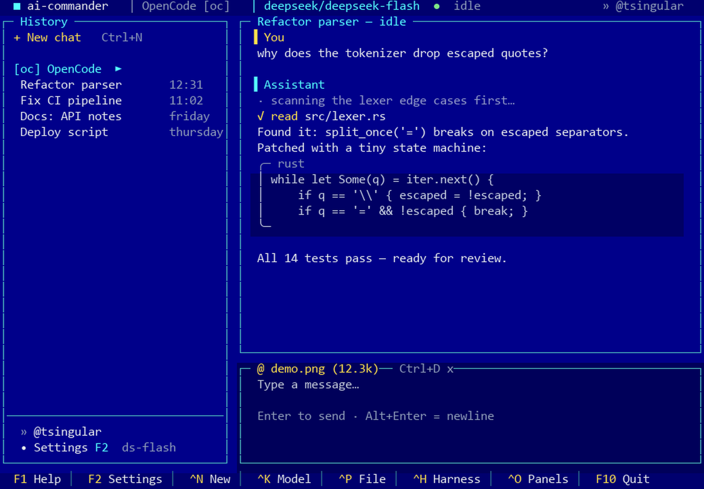

# ai-commander

[](docs/screenshot.png)

*(the image above is a rendered mockup of the real UI, generated from the
theme constants by `scripts/make-screenshot.py` — no real session data)*

ChatGPT-style TUI client for AI agent harnesses with the aesthetics of
DOS-era file managers (Norton Commander: box-drawing frames, F-key bar,
blue screen + silver dialogs) — written in Rust (ratatui + crossterm + tokio).

## Support matrix

| Harness | Kind | Streaming | Sessions | Attachments | Esc |
|---|---|---|---|---|---|
| OpenCode ≥ 2.2 | HTTP+SSE server (auto-started) | live deltas | server-side | images & files (≤8 MB) | detach* |
| Hermes Agent | CLI subprocess | live deltas | local registry | images via `--image` | real kill |
| DeepSeek Harness (`dsh`) | CLI subprocess (headless) | replace events | local registry | — | real kill |

\* opencode 2.2 exposes no abort endpoint: Esc stops following the turn; the
result loads when it finishes, and the next message interrupts it.

## How it works

The second harness is **Hermes Agent** (CLI): ai-commander drives the
`hermes chat` subprocess per message, streams its `--format stream-json`
deltas, keeps a local session registry with accumulated history (the CLI has
no session-list API), attaches images via `--image`, picks models from its
provider cache, and `Esc` really kills the running turn. Enable it with
`Ctrl+H` in the app or `enabled = true` in config.

The third harness is **DeepSeek Harness (`dsh`)** — also subprocess-driven via
`dsh --profile headless --json` (NDJSON `session`/`thinking`/`text`/`final`
events; thinking and answer arrive as cumulative replacements). The headless
profile's `--session-id` adopts a session but does not replay prior turns
into the model context, so the backend folds the stored conversation into the
task text itself. `DEEPSEEK_API_KEY` is taken from the environment or reused
from the local opencode auth store; `Esc` kills the running turn.

## Features

- ChatGPT layout: session history on the left, chat in the centre, composer
  at the bottom; profile + settings in the bottom-left corner
- Live token streaming (text, reasoning, tool calls) with markdown rendering
  and code blocks
- Pluggable harness architecture (`trait Backend`): opencode today,
  hermes-agent / deepseek-harness slots reserved in config and UI
- Model picker with a live list from the active harness, per-harness defaults
  and per-chat overrides (`Ctrl+K`)
- Attachments via an NC-style file browser (`Ins` marks files, `Tab` toggles
  drives)
- Full mouse support: clickable sessions, menus, modal rows and F-key buttons;
  wheel scrolling
- RU/EN interface with live switching (F2 → Language)

## Build

Windows without MSVC Build Tools? The repo pins the fully self-contained
`stable-x86_64-pc-windows-gnu` toolchain (see `rust-toolchain.toml`).

```bash
bash scripts/fetch-tools.sh # once: fetch dlltool.exe + as.exe from w64devkit
source scripts/gnu-env.sh   # puts tools/mingw-bin on PATH
cargo build --release
```

On MSVC machines simply delete `rust-toolchain.toml` and build with the
default toolchain. `dlltool`/`as` are needed only for the GNU target (raw-dylib
import libraries); they are not committed to the repo.

## Run

```bash
target/release/ai-commander                 # TUI (auto-starts opencode serve)
target/release/ai-commander --check         # headless: health, models, sessions
target/release/ai-commander --send "hello"  # E2E: real streamed model reply
target/release/ai-commander --server http://127.0.0.1:4096 --lang ru
```

Run inside **Windows Terminal** (UTF-8, emoji, mouse). The first launch creates
`config.toml` in the OS config directory (e.g. `%APPDATA%\ai-commander\`).

## Keys

| Key | Action |
|---|---|
| `Enter` | send · `Alt+Enter`/`Ctrl+J` — newline |
| `Esc` | stop following (the turn finishes in background; the next message steers it — the server has no abort) |
| `Ctrl+N` | new chat · `Ctrl+K` — model picker (live list) · `Ctrl+H` — harness |
| `Ctrl+P` | attach files (NC browser: `Ins` mark, `Tab` drives, `Enter` pick) |
| `Ctrl+O` | show/hide history · `Ctrl+D` — drop last attachment |
| `Tab` | focus history ↔ input · `PgUp/PgDn` — scroll · `End` — bottom |
| In history: `E` | rename session, `D`/`Del` — delete session |
| `F1` / `A` | help / About · `F2` — settings · `F10` — quit |

**Mouse**: click sessions / “+ New chat” / ⚙ Settings; the bottom F-keys are
real buttons; rows inside settings, model/harness/agent pickers and the file
browser are clickable; the wheel scrolls the chat and moves modal selection;
clicking the composer focuses it.

Settings (F2): language RU/EN (live), profile name, and per harness — server
URL (empty = autostart), server password (Basic auth), working directory,
agent (build/plan/…), default model. Everything persists in `config.toml`.

## Architecture

- `src/backend/mod.rs` — `trait Backend` (sessions, history, send, models,
  agents, event channel). New harnesses = new trait impls + a `[[harness]]`
  config entry.
- `src/backend/opencode.rs` — OpenCode v2 API: `/api/*` with Basic auth,
  `prompt` + SSE `/api/event` (`session.text.delta`, `session.reasoning.*`,
  `session.tool.*`, `session.execution.succeeded`), attachments as
  `files:[{uri:"data:…;base64", name}]`.
- `src/ui/*` — app state machine, sidebar/chat/composer, modals (NC file
  browser, settings, model/harness/agent pickers, 90s-style About), a custom
  text editor, markdown rendering (pulldown-cmark), the NC theme.

## Tests

```bash
cargo test   # 20: SSE/NDJSON mapping, markdown, i18n, config round-trip, wrap, editor, mime, atomic store
```

## Limitations & roadmap

- dsh headless does not replay session context on `--session-id`, so the
  backend folds stored history into the task text; `Esc` for opencode only
  detaches (no server abort); reasoning/tool history is not persisted for
  CLI harnesses (text only).
- The internal `trait Backend` is a purpose-built subset of what ACP covers;
  migrating to an ACP-based backend (`agent-client-protocol`, `opencode acp`)
  is the planned next architectural step, together with typed JSON models,
  a render cache for long chats, and per-harness permissions presets.
- MCP is the agent's concern: sessions can be pointed at MCP servers by the
  harness config; A2A is agent-to-agent and out of scope for a chat client.
- The screenshot is a mockup; a real capture (vhs) is on the wishlist.

## Author

**Mikhail Malyshev** — Telegram & YouTube: **@tsingular**

In-app About: `F1` → `A` (or `Ctrl+A`). © 2026 Mikhail Malyshev
